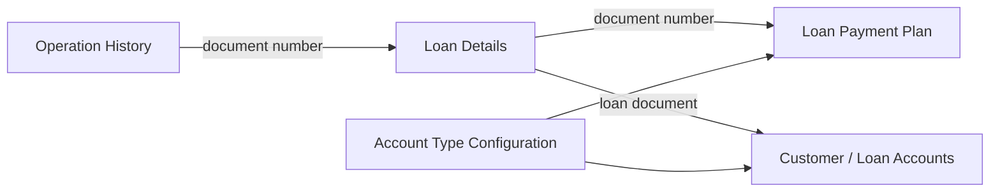

# Data Model — LOAN_API

> **Status:** Draft. This is a selective logical data model from the supplied source, not a complete database schema or ER diagram.

## Key Tables

| Table | Role observed in package body |
|---|---|
| `KRD_TEKLIF_DETAY` | Loan detail and identification by document number (`SENED_NO`) |
| `CS_ACCOUNT` | Loan-linked accounts and balance inputs |
| `LOAN_PAYMENT_PLAN` | Scheduled, paid and overdue payment data |
| `LOAN_ACC_TYPES_PR` | Account types and calculation/allocation groups |
| `KRD_PYM_ORDER` | Allocation settings used in loan amount calculations |
| `LOAN_INT_CALC_TYPES_PR` | Interest day-count and calculation conventions |
| `LOAN_OPERATION_HISTORY` | Recorded operation history and additional JSON details |
| `LOAN_HISTORY_MAPPING` | Configurable tag mapping to table/column fields |
| `LOAN_OPERATION_DESC` | Operation-to-transaction-caller mapping |
| `PKRD_TURKOD_PR` | Product settings including minimum overdue amount |

## Logical Relationships (illustrative)

**Important:** Arrows show relationships used by the package; they do not certify database foreign-key constraints. For the authoritative physical ER diagram, export table DDL and foreign keys from the target schema.

See also [Dependencies](reference/dependencies.md) and [Public API Reference](api/loan-api.md).
