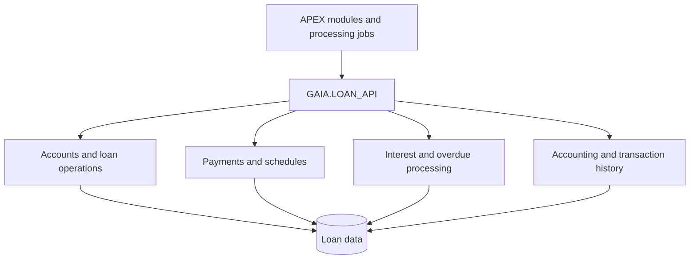

# LOAN_API — Technical Documentation

`GAIA.LOAN_API` is a public Oracle PL/SQL loan-services package for banking development and technical integration teams.

## Overview

`LOAN_API` provides shared functions and procedures for loan accounts, payments, repayment schedules, interest and overdue processing, accounting entries, and transaction history. The package exposes reusable operations rather than a single page-specific controller.

Its implementation interacts with loan master data, financial accounts, repayment plans, configuration tables and internal service packages. Review API-specific rules and transaction effects before calling methods that modify banking records.

## Documentation at a glance

| Document | What you will find |
|---|---|
| [API Reference](api.md) | Public procedures/functions, business logic and rules |
| [Workflows](workflows.md) | Verified processing paths and diagrams |
| [Data Model](data-model.md) | Referenced data objects and observed access |
| [Dependencies](dependencies.md) | Direct package and integration calls |
| [Error Handling](error-handling.md) | Significant source-visible failure conditions |

## Functional areas

| Functional area | Responsibility | APIs |
|---|---|---|
| [Loan operations and controls](api.md#domain-loan-operations-and-controls) | Coordinates loan operations, validation, and operational control checks. | [Browse APIs](api.md#domain-loan-operations-and-controls) |
| [Accounts, guarantees and closure](api.md#domain-accounts-guarantees-and-closure) | Manages loan-linked accounts, guarantees, collateral release, and closure activities. | [Browse APIs](api.md#domain-accounts-guarantees-and-closure) |
| [Payments and balances](api.md#domain-payments-and-balances) | Allocates and evaluates loan payments, plan amounts, and outstanding amounts. | [Browse APIs](api.md#domain-payments-and-balances) |
| [Payment schedules and dates](api.md#domain-payment-schedules-and-dates) | Produces and adjusts repayment schedules, installment dates, and grace-period information. | [Browse APIs](api.md#domain-payment-schedules-and-dates) |
| [Interest, penalties and rates](api.md#domain-interest-penalties-and-rates) | Calculates or retrieves interest, penalty bases, rates, and recognition information. | [Browse APIs](api.md#domain-interest-penalties-and-rates) |
| [Delinquency and status](api.md#domain-delinquency-and-status) | Determines overdue transitions, overdue dates, and related overdue processing. | [Browse APIs](api.md#domain-delinquency-and-status) |
| [Limits, tranches and overdrafts](api.md#domain-limits-tranches-and-overdrafts) | Evaluates credit limits, creates tranches, and processes overdraft contracts. | [Browse APIs](api.md#domain-limits-tranches-and-overdrafts) |
| [Accounting and audit](api.md#domain-accounting-and-audit) | Creates accounting postings and retrieves accounting mappings and journal information. | [Browse APIs](api.md#domain-accounting-and-audit) |
| [History, metadata and reversal](api.md#domain-history-metadata-and-reversal) | Captures transaction metadata and loan operation history, and supports reversal of recorded changes. | [Browse APIs](api.md#domain-history-metadata-and-reversal) |

## High-level workflow preview

The package spans several related loan capabilities rather than one fixed lifecycle. This diagram is a **conceptual capability overview**, not a prescribed execution order.

[Explore cross-cutting workflows](workflows.md)

## Key integration notes

- Accounting adjustments may call journal posting and history services; review [Dependencies](dependencies.md).
- Several methods are phase/date sensitive and accept EOD/SOD, transaction IDs, loan identifiers or branch ranges.
- Some implementations issue `COMMIT` explicitly; review transaction behavior in the [API Reference](api.md).
- Source-observed tables and joins are not proof of database foreign-key constraints; see [Data Model](data-model.md).
