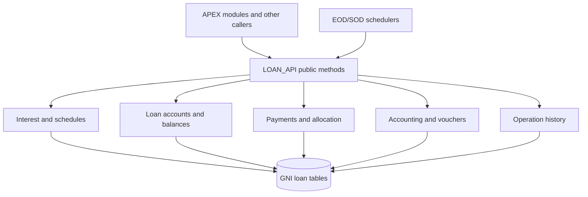

# LOAN_API — Overview

## Purpose

`LOAN_API` is a cross-module PL/SQL service package providing reusable loan functionality. The supplied package specification and body cover financial calculations, loan accounts, schedule generation, payments, accounting journals, history and batch operations.

It should be treated as **shared business infrastructure**, not as a single screen's controller.

## 2. Functional Areas

The public API is organized into the **same nine functional categories** used in the [API Reference](api/loan-api.md). Counts represent public declarations, including overloads as separate declarations.

| Functional Area | Public Declarations | Description |
|:--|--:|:--|
| **Loan operations and controls** | 6 | Loan-operation support functions, caller identification, offer-related utilities, and loan control processing. |
| **Accounts, guarantees and closure** | 8 | Loan account creation and features, account status changes, guarantee or collateral release, and loan closure operations. |
| **Payments and balances** | 5 | Loan amount retrieval, payment allocation and detail assembly, and automated loan payment processing. |
| **Payment schedules and dates** | 24 | Standard and annuity schedule generation, repayment dates, grace-period information, scheduled amounts, schedule checks, and adjustments. |
| **Interest, penalties and rates** | 18 | Interest-calculation periods and bases, interest processing, penalty calculation, rate information, and related financial calculations or operations. |
| **Delinquency and status** | 6 | Overdue date and threshold evaluation, delinquency transition decisions, and loan/account status handling. |
| **Limits, tranches and overdrafts** | 4 | Credit limit evaluation, tranche creation, and overdraft-related operations. |
| **Accounting and audit** | 9 | General-ledger mapping, journal entry generation and checking, voucher information, and change/audit support. |
| **History, metadata and reversal** | 11 | Additional operation information, grouped metadata, operation history, and reversal of tracked changes. |
| **Total** | **91** | **Public declarations, including overloaded variants.** |

These categories are **documentation navigation groups**, not isolated business modules. A method may participate in multiple processes even though it is documented under one primary category. For the complete method list, follow the [Public API Index](api/loan-api.md#public-api-index).

## Technical context

- **Technology:** Oracle Database / PL/SQL; uses APEX JSON and Oracle DBMS_SQL in selected routines.
- **Public contract:** `LOAN_API` package specification.
- **Implementation:** `LOAN_API` package body (roughly 10,000 lines in the supplied source).
- **State and custom types:** public collection types support account lists, voucher columns, journal entry lists, history data and date lists.
- **Operational risk:** Several methods write or delete financial and audit data. Never execute examples against production without an approved test plan.

## Architecture

**Diagram status:** conceptual; invocation relationships vary by method and are not implied for every call.
