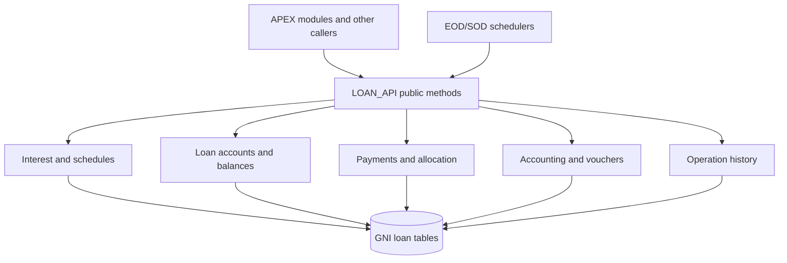

# LOAN_API — Overview

## Purpose

`LOAN_API` is a cross-module PL/SQL service package providing reusable loan functionality. The supplied package specification and body cover financial calculations, loan accounts, schedule generation, payments, accounting journals, history and batch operations.

It should be treated as **shared business infrastructure**, not as a single screen's controller.

## Functional areas

- **Accounts & Balances** — 14 public declaration(s).
- **EOD/SOD & Operations** — 12 public declaration(s).
- **History & Changes** — 13 public declaration(s).
- **Interest & Penalties** — 12 public declaration(s).
- **Journal & Vouchers** — 6 public declaration(s).
- **Payments & Allocation** — 5 public declaration(s).
- **Schedules & Rates** — 25 public declaration(s).
- **Utilities & Configuration** — 1 public declaration(s).

## Technical context

- **Technology:** Oracle Database / PL/SQL; uses APEX JSON and Oracle DBMS_SQL in selected routines.
- **Public contract:** `LOAN_API` package specification.
- **Implementation:** `LOAN_API` package body (roughly 10,000 lines in the supplied source).
- **State and custom types:** public collection types support account lists, voucher columns, journal entry lists, history data and date lists.
- **Operational risk:** Several methods write or delete financial and audit data. Never execute examples against production without an approved test plan.

## Architecture

**Diagram status:** conceptual; invocation relationships vary by method and are not implied for every call.
