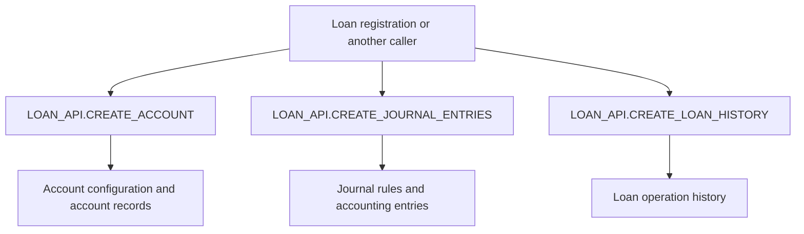
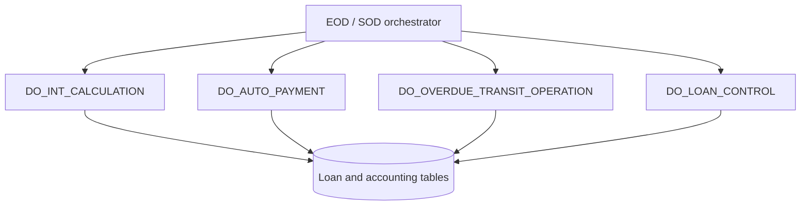
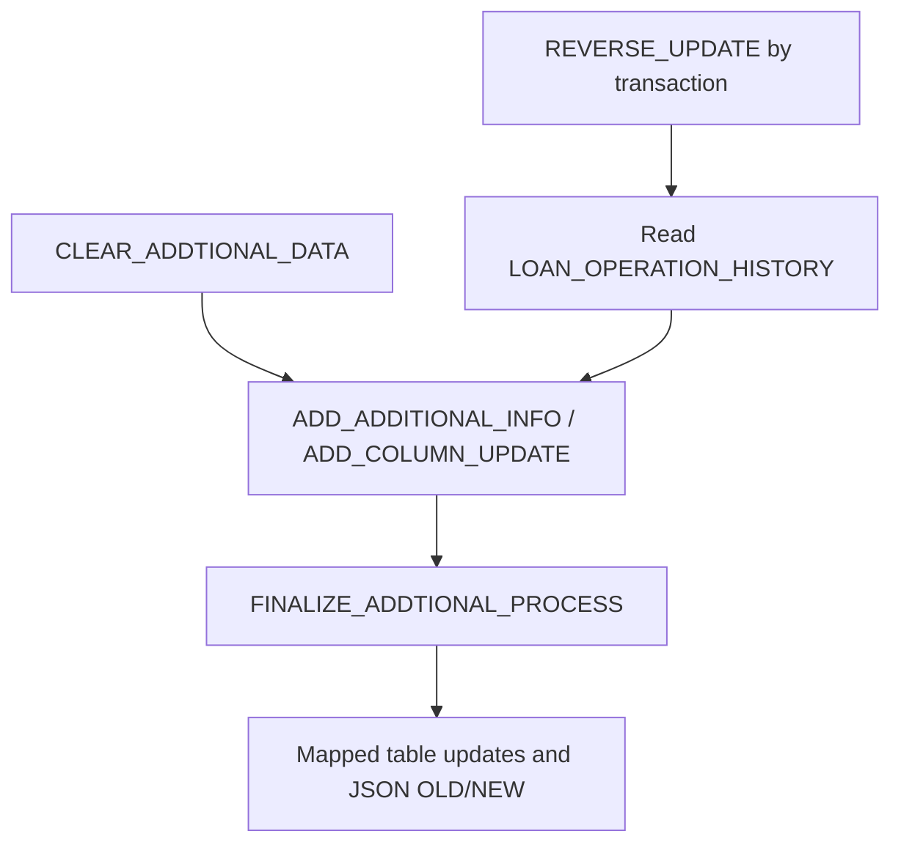

# Cross-cutting workflows

These diagrams represent **conceptual groupings** corroborated by the public API surface, not a complete call graph. Method-specific side effects require verification in the package body.

## Loan account creation and accounting

## EOD/SOD processing

**Note:** Parallel order and scheduling dependencies are **not established** here. These routines must not be treated as freely interchangeable steps.

## Loan history / reversible mapped updates

**Security note:** Source builds dynamic UPDATE statements from mapped metadata and values. Inspect quoting, privileges, concurrency and logging before exposing this capability to customers.
