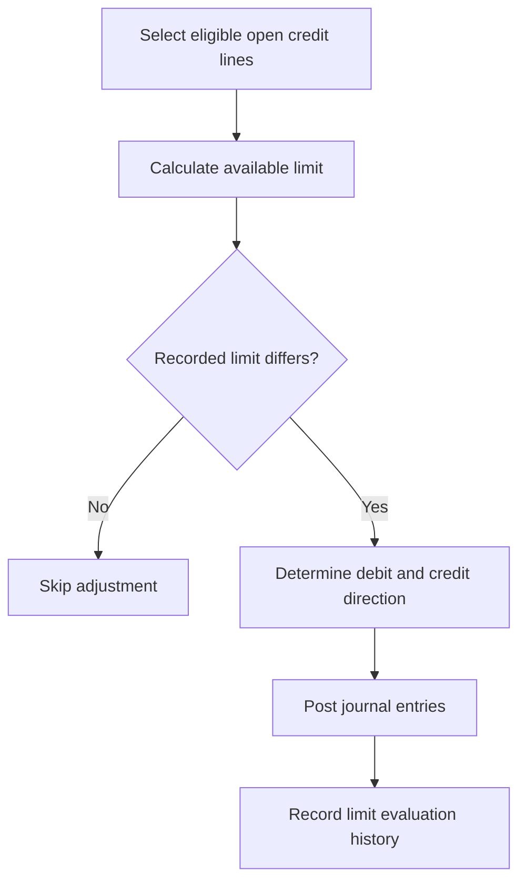
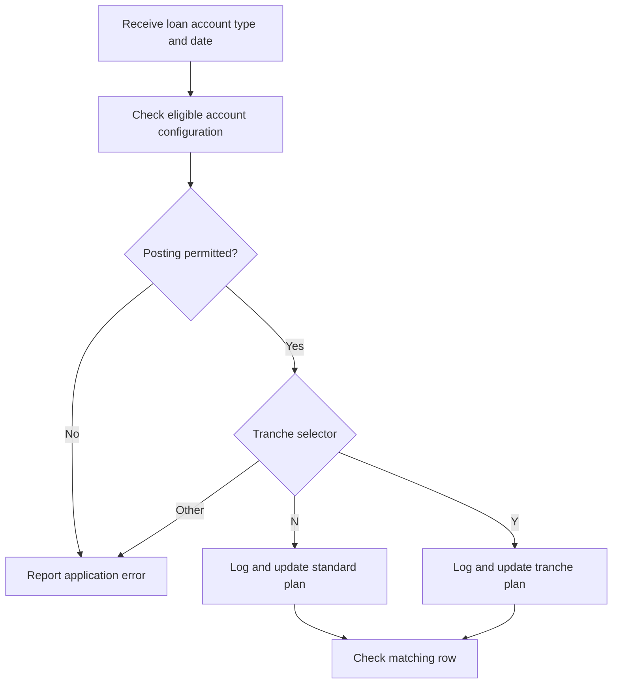
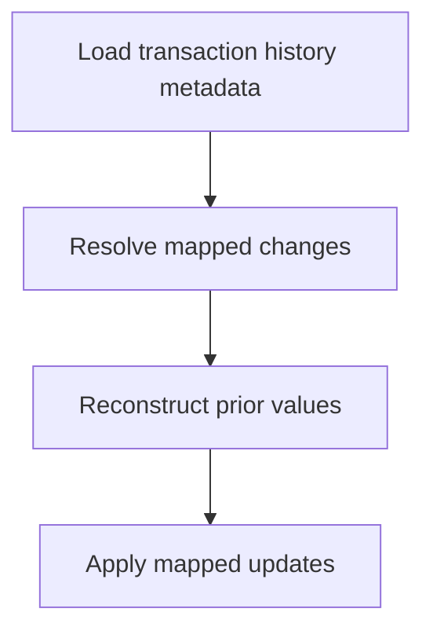

# LOAN_API — Verified Workflows

[← Overview](index.md) · [API Reference](api.md) · [Data Model](data-model.md)

These workflows describe source-observed processing, not a universal loan lifecycle. Execution order across independent EOD/SOD jobs is not established by the supplied package.

## Workflow index

- [Limit evaluation and adjustment](#workflow-limit-evaluation)
- [Interest amount posting to plan](#workflow-interest-posting)
- [History reversal and mapped updates](#workflow-history-reversal)

### Limit evaluation and adjustment

**Entry point:** [evaluate_limit_amount](api.md#evaluate-limit-amount)

**Purpose:** Align the recorded credit-line limit with the calculated available limit.

**Key rules:** Loan lines must meet the package's line-type, status, branch and optional document filters. Active category 667 or an elapsed loan end date sets the calculated limit to zero. Explicit commit occurs inside the loop only when both caller transaction ID and document filter are null.

**Effects:** Accounting entries and loan operation history are created for processed differences. [Data Model](data-model.md) · [Errors](error-handling.md)

### Interest amount posting to plan

**Entry point:** [post_int_amount_to_plan](api.md#post-int-amount-to-plan)

**Purpose:** Update scheduled interest amounts for either standard or tranche plans.

**Key rules:** Posting is explicitly restricted to the `INT` account-type group after the configuration lookup. Grace-payment rows retain their scheduled amount. A schedule-update type 3 with zero remaining main payment results in an early return.

**Effects:** Updates `LOAN_PAYMENT_PLAN` or `LOAN_TRANCHE_PAYMENT_PLAN`; calls table logging before DML. [Errors](error-handling.md)

### History reversal and mapped updates

**Entry point:** [reverse_update](api.md#reverse-update) and [finalize_addtional_process](api.md#finalize-addtional-process)

**Result:** The package uses additional history metadata and mapped updates to restore recorded values. The exact rollback/commit contract of dependencies is not determined from the supplied source; test transaction boundaries separately.

[↑ Overview](index.md)
